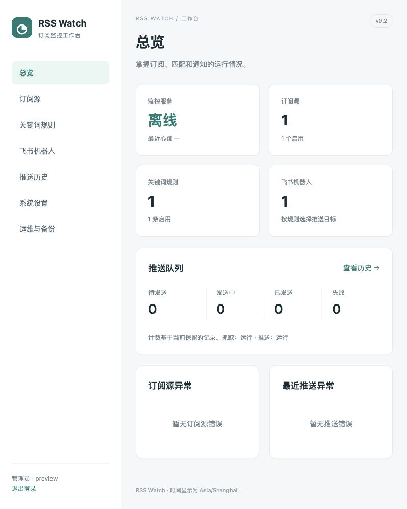

# RSS Watch

RSS / Atom 关键词监控工具。定时检查订阅标题，命中规则后发送到飞书群，支持中文管理后台、持久化推送队列和完整备份。

**v0.2.0 推荐使用 Docker Compose 部署。** Python 3.12+，SQLite；管理页面和静态资源随镜像提供。

[发布版本](https://github.com/imymi/rss-watch/releases) · [公开镜像](https://github.com/imymi/rss-watch/pkgs/container/rss-watch) · [测试状态](https://github.com/imymi/rss-watch/actions/workflows/tests.yml) · [更新记录](CHANGELOG.md)

## 版本选择

| 版本 | 部署与管理方式 | 数据库 | 获取 |
| --- | --- | --- | --- |
| **v0.2.0** | Docker Compose、中文网页后台，保留 CLI 和 systemd 部署 | schema 2 | [新版发布](https://github.com/imymi/rss-watch/releases/tag/v0.2.0) |
| **v0.1.0** | 原版 Linux / systemd、中文数字菜单和 CLI | schema 1 | [原版发布](https://github.com/imymi/rss-watch/releases/tag/v0.1.0)、[原版分支](https://github.com/imymi/rss-watch/tree/v0.1) |

原版完整源码保存在 `v0.1` 分支和 `v0.1.0` 标签中；新版位于 `main`，`v0.2.0` 标签固定本次发布。两个版本分别提供发布入口，原版的代码、依赖锁文件和 README 保持原样。

```sh
# 获取原版
git clone --branch v0.1.0 --depth 1 https://github.com/imymi/rss-watch.git rss-watch-v0.1
```

v0.2 能导入 v0.1 的完整备份。v0.1 不能直接读取 schema 2 数据库；回退必须恢复升级前的 schema 1 完整备份。

## 快速部署

准备 Docker Engine、Docker Compose 插件、curl，以及可访问 GHCR、订阅地址和飞书接口的网络。公开镜像支持 `linux/amd64` 和 `linux/arm64`，无需登录镜像仓库，也无需在部署机器安装 Python 或 uv。

```sh
mkdir rss-watch
cd rss-watch
curl -fL -o compose.yaml https://raw.githubusercontent.com/imymi/rss-watch/main/compose.yaml
curl -fL -o .env.example https://raw.githubusercontent.com/imymi/rss-watch/main/.env.example
cp .env.example .env
docker compose pull
docker compose up -d --no-build
docker compose exec web cat /data/bootstrap-token
```

以上下载当前 `main` 中的部署模板，`.env` 默认固定镜像版本 `0.2.0`。`v0.2.0` 源码标签保留发布时的本地构建配置，不需修改标签就能使用预构建镜像。

打开 **[http://127.0.0.1:8080](http://127.0.0.1:8080)**，用最后一条命令显示的一次性口令创建管理员，再登录。密码至少 12 个字符；口令使用后删除，不写入运行日志。

如果部署在服务器上，需要局域网直接访问，在 `.env` 中设置：

```dotenv
RSS_WATCH_BIND=0.0.0.0
RSS_WATCH_PORT=8080
```

执行 `docker compose up -d`，访问 `http://服务器地址:8080`。默认配置仅绑定部署机器的回环地址。

第一次使用按这个顺序配置：

1. 添加飞书群自定义机器人。
2. 添加 RSS / Atom 订阅地址。
3. 创建关键词规则，选择来源范围和目标机器人。
4. 在总览确认监控在线，在推送历史查看通知。

**新订阅第一次成功抓取只建立基线，不推送已有文章。** 此后首次发现的匹配文章才会产生通知。

## 管理后台



| 页面 | 可管理内容 |
| --- | --- |
| 总览 | 监控心跳、源/规则/机器人数量、推送队列、最近异常；队列与在线状态每 5 秒刷新 |
| 订阅源 | 添加、编辑名称和间隔、启用/停用、删除，查看初始化状态、最近成功时间和错误 |
| 关键词规则 | 包含词、排除词、任一/全部匹配、来源范围、目标机器人、启停、删除和标题测试 |
| 飞书机器人 | 名称、Webhook、签名密钥、发送测试消息、删除 |
| 推送历史 | 按状态/机器人筛选、分页、完整消息、命中规则、错误原因、失败任务重试 |
| 系统设置 | 抓取与网络参数、代理、重试与限流、历史保留、自动备份、时区、管理员密码 |
| 运维与备份 | 暂停/恢复抓取和推送、数据库/凭据检查、运行日志、管理操作记录、在线备份、下载与恢复 |

规则关键词在网页里**每行一个**。来源不选择表示全部订阅源；清空已有来源范围时需要勾选确认。

编辑机器人时，Webhook 留空保留现有凭据。填写新 Webhook 时，签名密钥留空表示关闭加签。已有凭据不会返回页面或机器人列表 API。

### 飞书配置

使用飞书群设置中的**自定义机器人**，无需 App ID / App Secret。复制机器人的 HTTPS Webhook，可选填写签名密钥。

- 启用飞书关键词校验时，允许词应包含 `RSS 命中提醒`。
- 启用签名校验时，在后台填写对应密钥。
- 使用 IP 白名单时，填写服务器出口 IP。
- “测试消息”会真实发送到目标群，并经过同一持久队列、限流与重试机制。

机器人仍被规则引用，或者存在未完成/失败任务时，不能删除。

## 运行设置

业务配置保存在数据库中，可在后台修改。worker 每秒读取设置；网络配置改变时重建 HTTP 客户端，页面显示设置是否仍待应用。部署端口、卷挂载和容器升级由 Compose 管理。

| 设置 | 默认值 | 可设置范围或说明 |
| --- | --- | --- |
| 新订阅默认抓取间隔 | 300 秒 | 60–86400 秒；已有源使用自己的间隔 |
| 订阅源数量上限 | 100 | 1–1000 |
| 抓取并发数 | 5 | 1–20 |
| 连接超时 / 请求总时限 | 10 / 30 秒 | 1–120 / 1–300 秒 |
| 解压后订阅响应上限 | 5 MiB | 1–50 MiB |
| HTTP / HTTPS 代理 | 空 | 留空沿用部署环境；支持 HTTP/HTTPS 代理地址 |
| 代理排除地址 | 空 | 逗号分隔的主机名或 IP；`*` 全部直连；该字段不支持 CIDR |
| 最多发送次数 | 5 次，含首次 | 1–10 |
| 重试间隔 | 30、120、600、1800 秒 | 1–10 个间隔；超出数量沿用最后一个 |
| 每机器人发送间隔 | 1 秒 | 1–60 秒 |
| 抓取失败退避上限 | 3600 秒 | 60–86400 秒 |
| 已发送历史保留 | 90 天 | 1–3650 天 |
| 历史清理周期 | 24 小时 | 1–168 小时 |
| 自动备份周期 / 保留数量 | 24 小时 / 7 份 | 周期 0–720 小时，0 关闭；保留 1–100 份 |
| 页面时区 | Asia/Shanghai | IANA 时区，例如 UTC |

源数量与并发上限是允许配置的范围，实际承载量取决于服务器和订阅站点。调整这些参数时，应同时关注抓取错误和队列积压。

**暂停抓取**后仍可发送已入队消息；**暂停推送**后仍可抓取并积累任务。暂停状态跨重启保留。在途请求可能完成；客户端切换造成的发送中断会按持久队列恢复。

## Docker 配置与日常运维

同一镜像运行两个服务：`web` 提供后台和自动备份，`worker` 抓取订阅并推送。关闭网页或重启 web 不会停止 worker；web 停机期间自动备份调度暂停。

| `.env` 变量 | 默认值 | 用途 |
| --- | --- | --- |
| RSS_WATCH_BIND | 127.0.0.1 | 宿主机监听地址 |
| RSS_WATCH_PORT | 8080 | 宿主机端口 |
| RSS_WATCH_IMAGE | ghcr.io/imymi/rss-watch | 镜像仓库与名称，不含标签 |
| RSS_WATCH_VERSION | 0.2.0 | 已发布镜像的版本标签；生产部署建议固定版本 |
| TZ | Asia/Shanghai | 容器时区；页面时区另在后台设置 |
| RSS_WATCH_SECURE_COOKIES | 0 | HTTPS 访问时设为 1 |
| RSS_WATCH_TRUSTED_PROXIES | 127.0.0.1 | 实际反向代理地址，多个地址逗号分隔 |

使用 HTTPS 反向代理时，设置 Secure Cookie 和实际可信代理地址；代理转发到 web 的 8080 端口。设置 Secure Cookie 后应使用 HTTPS 访问。

### 镜像与源码构建

```sh
docker pull ghcr.io/imymi/rss-watch:0.2.0
# 同一版本的别名
docker pull ghcr.io/imymi/rss-watch:v0.2.0
```

`latest` 指向当前最新正式 Release 对应的镜像。`0.2.0` / `v0.2.0` 固定版本；需要严格锁定内容时可使用 Package 页面显示的 SHA256 digest。

默认 `compose.yaml` 只拉取镜像。需要修改源码时，在当前 `main` 源码目录使用独立构建配置：

```sh
RSS_WATCH_VERSION=local docker compose -f compose.yaml -f compose.build.yaml up --build -d
```

已有本地构建部署改为拉取镜像时，替换部署模板，将 `.env` 中的 `RSS_WATCH_VERSION=local` 改为 `0.2.0`，再执行 `docker compose pull` 和 `docker compose up -d --no-build`。沿用原 Compose 项目名和卷，先下载完整备份。

GitHub Actions 的 `publish-image` 流程从已存在的稳定版本标签构建；先验证版本号、Python 测试及 Docker 集成测试，再发布两种架构。镜像标注源码提交；已存在的版本标签禁止覆盖，只有当前最新正式 Release 更新 `latest`。首次发布可在 Actions 中手动选择 `v0.2.0`；以后发布正式 Release 自动触发。发布后分别在原生 amd64 / arm64 runner 上测试匿名拉取、启动、设置与数据保留及只读凭据卷。

GHCR Package 的 Public 设置独立于代码仓库；首次发布后需在 Package Settings 中设为 Public。若首次验证因权限失败，公开后重跑失败的验证任务即可，无需重建或覆盖版本镜像。

```sh
docker compose ps
docker compose logs --tail 100 worker
docker compose exec worker rss-watch-container check-worker
docker compose exec web rss-watch --config /app/container.toml status
docker compose restart worker
docker compose down
```

应用以 UID/GID `10001` 运行，根文件系统只读。数据使用两个命名卷：

| 卷 | 容器位置 | 内容 |
| --- | --- | --- |
| rss-data | /data | SQLite、设置、会话、日志、备份 |
| rss-credentials | /credentials | 飞书凭据；worker 中只读 |

Compose 默认项目名为 `rss-watch`，实际卷名带项目前缀。`docker compose down` 保留卷；**`docker compose down --volumes` 会删除数据和凭据**。迁移或重装时保持项目名及卷配置一致。

改用绑定目录时，准备专属目录并设置归属 `10001:10001`、权限 `0700`，凭据文件保持 `0600`。SQLite 必须放在本机文件系统上，不能依赖跨机器共享 WAL 的网络文件系统。每套数据只运行一个 worker，不要扩容 worker。

健康检查显示状态；Docker 不会仅因为 `unhealthy` 自动重启，进程异常退出由重启策略恢复。暂停监控和维护模式属于预期状态。运行日志按服务轮转，每个服务最多保留 4 个 1 MiB 文件。

## 备份、恢复与版本迁移

### 创建备份

在“运维与备份”点击“立即备份”，然后下载 ZIP。备份包含数据库、设置和活动机器人凭据，也包含密钥，应限制访问。

自动备份默认每 24 小时执行，保留最近 7 份。数量限制只清理 `auto-` 备份；手动备份和恢复前的 `pre-restore-` 备份需自行删除。

### 从 v0.1 / systemd 迁移到 v0.2 Docker

1. 停止旧服务，退出所有管理 CLI，使用旧版本生成最终完整备份：

   ```sh
   sudo systemctl stop rss-watch
   rss-watch backup /绝对路径/完整备份目录
   ```

2. 在完整备份目录中，用有权限读取备份的用户打包并下载到管理电脑：

   ```sh
   python3 -m zipfile -c /安全路径/rss-watch-import.zip rss-watch.sqlite3 manifest.json credentials
   ```

3. 部署 v0.2，在后台创建管理员，进入“运维与备份”，上传 ZIP，输入“恢复”确认。
4. 恢复后重新登录，检查订阅、规则、机器人、基线和推送历史。
5. 点击“退出维护模式”，再分别恢复抓取和推送。

导入保留文章指纹、源初始化状态和事件 ID，避免重新推送所有历史文章。旧服务与新 worker 不应同时监控同一套业务数据。

### 恢复流程

系统会先校验备份版本、数据库完整性和活动凭据集合，再进入维护模式，等待 worker 释放数据锁，保存当前完整备份，最后恢复。

恢复失败会尝试回滚；意外中断时保持维护模式，恢复前备份名称保存在 `/data/maintenance`。恢复完成后保留当前管理员密码，注销旧会话，暂停抓取和推送，等待检查。应从后台退出维护模式，不要直接删除维护文件绕过检查。

网页上传最多 **100 MiB**，解压后最多 **512 MiB**。更大的完整备份目录可只读挂载到 web 的 `/import`，确保 UID 10001 可读，再执行：

```sh
docker compose exec web rss-watch --config /app/container.toml restore /import --yes
```

CLI 与网页使用同一恢复流程。`--yes` 表示已确认覆盖当前业务数据。

### 升级与回退

升级前下载完整备份并记录当前镜像版本。将 `.env` 的 `RSS_WATCH_VERSION` 改为目标已发布版本，沿用项目名和原数据卷，再执行 `docker compose pull` 与 `docker compose up -d --no-build`。若目标版本调整部署模板，应先按其发布说明更新模板。源码构建部署使用 `compose.build.yaml`。

schema 1 会自动加表迁移到 schema 2，迁移前另存 `migration-v1-*.sqlite3` 数据库快照。**数据库快照不含凭据，不能替代完整备份。**

回退到 v0.1 时，停止新版服务，恢复升级前的 schema 1 数据库及对应凭据，再启动匹配的旧版程序。只换回旧代码或镜像而保留 schema 2 数据库，旧版无法启动。恢复旧备份也可能重新发送备份之后已送达的通知。

## 监控与匹配行为

- 匹配范围只有**标题**；摘要仅用于消息展示。包含词和排除词均为字面子串，采用 HTML 清理、NFKC 标准化和忽略大小写的比较，不使用正则、分词或词边界。
- `any` 要求至少一个包含词命中，`all` 要求全部包含词命中；任一排除词命中即排除。
- 第一次有效抓取建立基线，包括有效空源；畸形 XML 或抓取失败不会标记已初始化。
- 文章按首次发现判断新增，不按发布时间过滤。身份优先使用 GUID / Atom ID，其次链接，最后标题和时间组合哈希；去重范围为单个源，同身份文章修改不重推。
- 同一文章、同一机器人命中多条规则时合并通知。规则变更只影响之后发现的文章；已入队任务保留原消息快照。
- URL 是订阅源身份。更换 URL 请删除旧源再新增，新源重新建立基线。停用、删除源不会撤销已入队任务；删除源保留原指纹和历史。
- 使用 ETag / Last-Modified 条件请求，文章、命中、任务及验证信息在同一事务提交。轮询无法发现两次抓取之间已经从源中移除的文章。
- 推送采用**至少一次投递**。远端可能已接收而本地超时，因此偶发重复仍可能发生；消息中的稳定事件编号用于识别重复。
- 重试遵守更长的 `Retry-After`。签名和凭据等永久错误等待人工修复；手动重试重置尝试次数，保留事件编号。
- 已发送任务和完整文章内容默认保留 90 天；精简指纹及未完成/失败任务继续保留。数据时间使用 Unix UTC，页面按所选时区显示。

## CLI 与原生 Linux 部署

Docker 中可直接调用 CLI：

```sh
docker compose exec web rss-watch --config /app/container.toml menu
docker compose exec web rss-watch --config /app/container.toml source list --json
docker compose exec web rss-watch --config /app/container.toml history --state failed --detail
```

原生 systemd 需要 Linux、Python 3.12+、uv、CA 证书和正确系统时间。在选定版本的源码目录执行 `sudo ./deploy/install.sh`；默认配置在 `/etc/rss-watch/config.toml`，数据在 `/var/lib/rss-watch`，代码在 `/opt/rss-watch/releases`，`current` 指向活动版本。

安装器保留配置、数据和凭据，升级前创建并校验完整备份。新服务启动失败时先确认停止；若数据库版本已迁移，恢复旧 schema 和活动凭据，再回退代码并验证旧服务运行状态。

```sh
rss-watch menu
rss-watch status --detail
rss-watch check
rss-watch logs
rss-watch restart
```

`check`、`logs`、`restart` 等宿主机运维命令由 systemd 安装器提供；Docker 使用 Compose 命令管理容器。

CLI 支持源/规则的 `add`、`update`、`enable`、`disable`、`delete`，机器人管理及测试，`rule test`、`history`、`delivery retry`、`backup`、`restore`。完整参数见 `rss-watch --help` 及各子命令帮助。

原生卸载默认保留数据；执行前可预览：

```sh
sudo /opt/rss-watch/current/deploy/uninstall.sh --dry-run
sudo /opt/rss-watch/current/deploy/uninstall.sh
# 明确需要清空时，使用 --purge，并完成确认
```

原版详细菜单、systemd 安装与运维文档见 [v0.1 README](https://github.com/imymi/rss-watch/blob/v0.1/README.md)。

## 本地开发

```sh
uv sync --locked --python 3.12
uv run rss-watch --config "$PWD/.local/config.toml" init \
  --data-dir "$PWD/.local/data" --credentials-dir "$PWD/.local/credentials"
uv run rss-watch-container web --config "$PWD/.local/config.toml"
# 另一个终端
uv run rss-watch --config "$PWD/.local/config.toml" run
```

本地后台监听 8080，初始化口令在 `.local/data/bootstrap-token`。`init` 不覆盖已有配置。配置优先级为 `--config`、`RSS_WATCH_CONFIG`、`/etc/rss-watch/config.toml`，目录须为绝对路径。

```sh
uv run ruff check .
uv run pytest -q
uv build
# 有 Docker 的环境：隔离 Compose 项目与数据卷进行集成测试
RSS_WATCH_DOCKER_TEST=1 uv run pytest -q tests/test_docker.py
# 测试已发布镜像（只拉取、不构建）
RSS_WATCH_DOCKER_TEST=1 RSS_WATCH_DOCKER_IMAGE=ghcr.io/imymi/rss-watch:0.2.0 \
  uv run pytest -q tests/test_docker.py
```

CI 包含 Python 测试与 Linux Docker 集成测试。验证范围和记录见 [VALIDATION.md](VALIDATION.md)。

## 管理 API

API 使用管理员登录 Cookie。`GET /api/session/csrf` 获取 CSRF 校验值，写请求携带 `X-CSRF-Token`。机器人列表只返回 ID 和名称；规则的 includes、excludes、source_ids 返回数组。

| 请求 | 用途 |
| --- | --- |
| GET /api/status、/api/health | 运行状态与数据库/凭据检查 |
| GET /api/sources、/api/rules、/api/bots | 配置列表 |
| GET /api/history?state=failed&limit=30 | 推送历史，limit 为 1–1000 |
| GET /api/settings | 全局设置 |
| POST /api/sources、/api/rules、/api/bots | 创建记录 |
| PUT /api/sources/{id}、/api/rules/{id}、/api/bots/{id} | 完整更新记录 |
| POST /api/settings | 修改指定设置，接收键值对象 |
| POST /api/{sources\|rules}/{id}/{enable\|disable\|delete} | 启停或删除 |
| POST /api/bots/{id}/{test\|delete} | 测试消息或删除机器人 |
| POST /api/rules/{id}/test | 检查标题，接收 `{"title":"AI 新消息"}` |
| POST /api/deliveries/{event}/retry | 重试失败事件 |

规则写入示例：

```json
{
  "name": "AI 动态",
  "includes": ["AI", "人工智能"],
  "excludes": ["广告"],
  "mode": "any",
  "source_ids": [1],
  "bot_id": 1
}
```

来源空数组表示全部源。规则测试只返回匹配结果，不发送通知。

## 常见问题

**监控离线怎么办？** 先检查 `docker compose ps` 和 worker 日志，再运行 `check-worker`。心跳超过 10 秒视为离线；在线只表示监控循环有有效心跳。

**第一次抓取为什么没有消息？** 首次抓取建立基线，这是预期行为。之后新出现的标题需命中已启用规则，且推送未暂停。

**为什么“测试消息”一直待发送？** 测试消息由 worker 发送；检查 worker 是否在线、推送是否暂停、是否仍处于维护模式。

**为什么恢复后监控没有继续？** 恢复保留维护模式并暂停抓取/推送，需先检查数据、退出维护模式，再分别恢复两项功能。

**容器里的 localhost 指向哪里？** 指向该容器自身。访问宿主机上的 RSS 服务时，应填写容器能访问的宿主机地址，或为两个服务配置可互通的 Docker 网络。

**如何查看当前机器人密钥？** 后台支持替换，不回显已有密钥。完整备份含凭据，凭据文件以 `0600` 保存、目录以 `0700` 保存；数据库只存文件引用。
